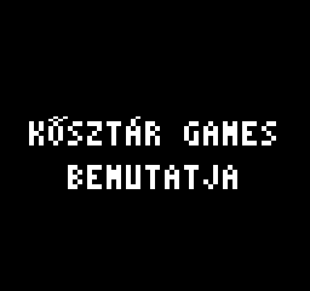
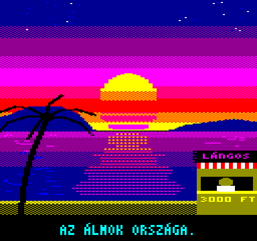
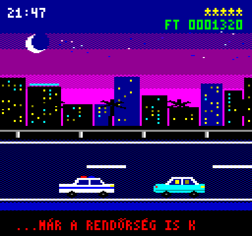
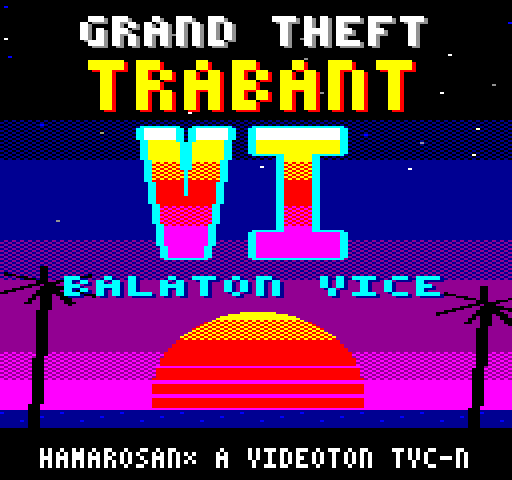
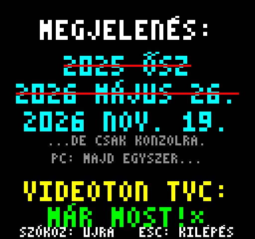

# GRAND THEFT TRABANT VI – BALATON VICE

Paródia-„trailer” demó **Videoton TV-Computer 64K**-ra. 16 színű mód (128×240), Z80 gépi kód, `10 PRINT USR(6659)` BASIC betöltővel, automatikus indítással.

**Kész fájl:** [`dist/gtt6.cas`](dist/gtt6.cas) (19,8 KB)

▶️ **Videó a demóról:** https://www.youtube.com/watch?v=sxfMsHoAQMc


## Jelenetek (kb. 70 másodperc, körbe megy)

| | |
|---|---|
|  | **1. KŐSZTÁR GAMES BEMUTATJA**: felirat be- és kiúsztatással. |
|  | **2. Naplemente a Balatonon**: lemenő, csíkos retró-nap, hullámzó tükröződés a vízen, a Badacsony sziluettje, pálmafa, villogó LÁNGOS neon, „3000 FT” árcédula. Synthwave-arpeggio szól. |
|  | **3. Üldözés a parti úton**: Lujza és Jani a zötyögő Trabantban, a háttérben elhaladó siófoki városkép, suhanó szalagkorlát és felezővonal. Beér a villogó rendőrautó, szól a sziréna, felgyűlik az 5 körözési csillag, pörög a forintszámláló. |
|  | **4. Címkép**: GRAND THEFT TRABANT VI, villogó BALATON VICE felirat, fanfár. |
|  | **5. Megjelenés**: 2025 ŐSZ ~~áthúzva~~, 2026 MÁJUS 26. ~~áthúzva~~, 2026 NOV. 19. …de csak konzolra. PC: majd egyszer… VIDEOTON TVC: MÁR MOST!* |

A feliratok gépelve jelennek meg, ékezetes nagybetűkkel (saját 3×5-ös font, ékezetsorral). Minden grafika saját rajz; ez paródia, nem kapcsolódik a Rockstar Games-hez.

## Irányítás

| Billentyű | Funkció |
|---|---|
| Szóköz / joystick tűz | következő jelenet |
| Esc | kilépés a BASIC-be |

## Fordítás

Kell hozzá: Python 3 + Pillow, [sjasmplus](https://github.com/z00m128/sjasmplus).

```
./build.sh          # gen.py -> data.inc, sjasmplus -> gtt6.bin, mkcas.py -> gtt6.cas
```

- `gen.py`: minden grafikát és adatot előállít (font, a három háttérkép bájt-RLE-vel, sprite-ok, a nap és a tükröződés táblái, zene és hangeffektek, feliratok és idővonalak), és előnézeti képeket is ment (`preview_*.png`).
- `gtt6.asm`: a demómotor és a jelenetek. A rendszerrutinok (vsync, billentyűzet, kilépés, hang, RLE) a korábbi TVC-projektekből (Árnyékjárás, BLOKK 3D) jönnek.
- `mkcas.py`: CAS-csomagoló (autorun, unbuffered).
- `harness/tvcsim.c`: minimális TVC 64K tesztkörnyezet (képmentés, hangnapló, képkocka-profilozás a `$FE` porton). Fordítás: a [superzazu/z80](https://github.com/superzazu/z80) `z80.c`/`z80.h` fájljaival, `gcc -O2 -o tvcsim tvcsim.c z80.c`.

## Időzítés

A tvcsim-ben mérve minden jelenet tartja az 50 képkocka/s-ot. Csak jelenetváltáskor, egy-egy új felirat kezdetén és az utolsó, álló szöveges képen késik egy-egy képkocka.

- Városkép: 54 sor, 2 képkockánként 1 bájttal forog, felváltva a két fele, kibontott LDI-vel.
- Korlát és felezővonal: mintasorból másolva, fázisléptetéssel (4, ill. 6 képpont/képkocka).
- Nap: csak a saját oszlopait rajzolja újra, a soronként egyszínű ég-táblából.
